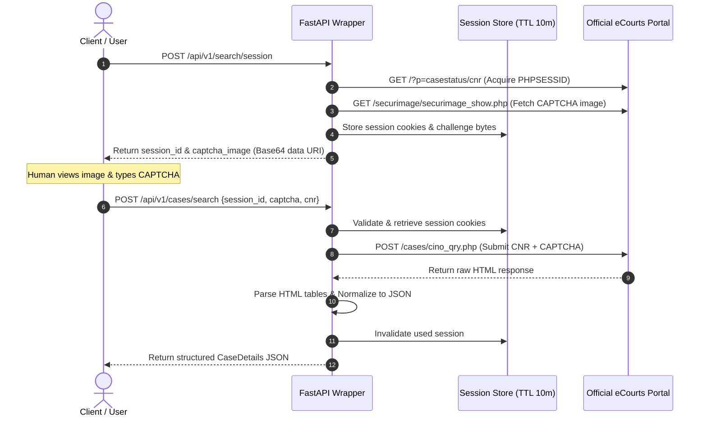

# Comprehensive Research: Official eCourts Public Services & System Architecture

This document provides technical documentation on India's official **eCourts Services** platform, detailing its public search capabilities, session dynamics, CAPTCHA mechanisms, parameters, and machine-readable data structures.

---

## 1. Executive Summary & Overview of Official Platforms

India's e-Courts mission mode project operates under the e-Committee of the Supreme Court of India and the Department of Justice. The digital infrastructure exposes case status, daily orders, cause lists, and final judgments through three primary web portals:

| Platform | Primary Domain | Target Jurisdiction | Backend System |
|---|---|---|---|
| **District Court Services** | `services.ecourts.gov.in` | District & Taluka Courts across 36 States/UTs | CIS (Case Information System) 3.2 / PHP |
| **High Court Services** | `hcservices.ecourts.gov.in` | 25 State High Courts & respective Benches | CIS High Court National Core |
| **eCourts Judgment Search** | `judgments.ecourts.gov.in` | High Courts & Supreme Court Judgments | Elastic / Solr backed full-text index |

---

## 2. Official Machine-Readable Interfaces & API Availability

### Official API Investigation:
1. **Public REST APIs**: The official public portals (`services.ecourts.gov.in`, `judgments.ecourts.gov.in`) **do not provide an open, unauthenticated public REST API without CAPTCHA** for commercial or general public third-party access.
2. **eCourts Mobile App APIs**: The mobile application utilizes secure HTTPS endpoints backed by session tokens, device signatures, and server-side rate-limiting.
3. **Judicial Data Exchange**: Government departments and law enforcement access automated feeds via dedicated secure gateways (e.g., NSTEP, ICJS) requiring pre-authorized departmental credentials and IP whitelisting.

### Wrapper Architectural Decision:
Because no public unauthenticated API exists, the FastAPI wrapper interacts with official public service endpoints using **server-side HTTP integration with a permitted Human-in-the-Loop (HITL) session flow**.

---

## 3. Primary Search Mode: CNR (Case Number Record)

The **CNR Number** is the unique 16-character alphanumeric identifier assigned to every court case in India.

### CNR Structure Breakdown:
Example: `MHAU010001892015`

```
  MH      AU        01          000189         2015
[State] [Dist] [Establishment] [Case Number] [Filing Year]
```

* **State Code (Chars 1–2)**: 2-letter postal code (e.g., `MH` = Maharashtra, `DL` = Delhi, `KA` = Karnataka, `UP` = Uttar Pradesh).
* **District Code (Chars 3–4)**: 2-character district code (e.g., `AU` = Aurangabad, `HC` = High Court, `SW` = South West Delhi).
* **Establishment / Court Complex Code (Chars 5–6)**: 2-character code identifying the specific court complex within the district.
* **Case Number (Chars 7–12)**: 6 digits, zero-padded case filing sequence number.
* **Year (Chars 13–16)**: 4-digit filing year (e.g., `2015`).

### Official CNR Query Workflow:
1. **Session & Cookie**:
   * Landing URL: `https://services.ecourts.gov.in/ecourtindia_v4/?p=casestatus/cnr`
   * Cookie: `PHPSESSID` (tied to client session).
2. **CAPTCHA Challenge**:
   * Challenge URL: `https://services.ecourts.gov.in/ecourtindia_v4/securimage/securimage_show.php`
   * Format: PNG image (typically 5 to 6 alphanumeric characters).
3. **Submission**:
   * Endpoint: `POST https://services.ecourts.gov.in/ecourtindia_v4/cases/cino_qry.php`
   * Content-Type: `application/x-www-form-urlencoded`
   * Parameters:
     * `cino`: 16-character CNR string.
     * `captcha_code`: User-solved CAPTCHA string.
     * `fdate`: Optional filter date.
     * `search_mode`: `cnr`.

---

## 4. Secondary Search Types

When the CNR is unknown, the official eCourts platform exposes alternative search criteria. All secondary searches require specifying the **State**, **District**, and **Court Complex / Establishment**:

| Search Type | Parameters Required | Return Information |
|---|---|---|
| **Case Number** | `state_code`, `dist_code`, `court_complex_code`, `case_type`, `case_number`, `case_year` | Single matching case details and history |
| **Party Name** | `state_code`, `dist_code`, `court_complex_code`, `party_name`, `case_year`, `status` (Pending/Disposed/Both) | List of matching cases with petitioner/respondent names |
| **Advocate Name** | `state_code`, `dist_code`, `court_complex_code`, `advocate_name`, `case_year` | List of cases represented by the advocate |
| **Court Orders** | `state_code`, `dist_code`, `court_complex_code`, `order_date`, `court_number`, `party_name` | Table of interim and final orders with PDF links |
| **FIR Number** | `state_code`, `dist_code`, `court_complex_code`, `police_station_code`, `fir_number`, `fir_year` | Criminal cases arising from the specific FIR |
| **Act / Section** | `state_code`, `dist_code`, `court_complex_code`, `act_code`, `section` | Cases registered under specified penal or civil statutes |

---

## 5. CAPTCHA Handling: Policy & Human-in-the-Loop Design

### Strict Policy:
* **No CAPTCHA Bypass or Circumvention**: In accordance with the system specification and legal ethics, the service does not attempt to defeat, crack, or bypass government anti-bot protections.
* **Permitted Human-in-the-Loop Flow**: The API exposes a stateful session workflow that enables client applications (e.g. web frontends, mobile apps, or human operators) to receive the official CAPTCHA challenge and solve it.

### Workflow Sequence:



---

## 6. Response Normalization & Schema Mapping

The eCourts web interface returns raw, unstructured HTML tables. The wrapper normalizes these into structured JSON models:

| HTML Table / Field in eCourts | Normalized Field in `CaseDetails` | Type |
|---|---|---|
| `CNR Number` | `cnr` | `str` (16 chars) |
| `Case Type` | `case_type` | `str` |
| `Filing Number` / `Filing Date` | `filing_number`, `filing_date` | `str` |
| `Registration Number` / `Reg Date` | `registration_number`, `registration_date` | `str` |
| `Case Status` / `Nature of Disposal` | `status`, `disposal_nature` | `str` |
| `First Hearing Date` / `Next Hearing Date` | `first_hearing_date`, `next_hearing_date` | `str` (DD-MM-YYYY) |
| `Petitioner` / `Advocate` | `petitioner`, `petitioner_advocate` | `str` |
| `Respondent` / `Advocate` | `respondent`, `respondent_advocate` | `str` |
| `Court Number and Judge` | `court` | `str` |
| `Under Act(s)` / `Section(s)` | `acts` | `List[ActSectionItem]` |
| `Business on Date` table | `case_history` | `List[CaseHistoryItem]` |
| `Orders` table with PDF links | `orders` & `documents` | `List[OrderItem]`, `List[DocumentItem]` |

---

## 7. Status of Functionality & Roadmap

* **Confirmed & Fully Verified**:
  - CNR format validation (State codes, 16-character structure, year checks).
  - Human-in-the-loop session generation and Base64 challenge serialization.
  - Multi-table HTML parsing (case info, status, coram, parties, history timeline, orders).
  - Order PDF URL extraction and metadata parsing.
  - Mock mode fallback for local development and test automation.
* **Subject to Portal Accessibility**:
  - Direct live portal queries depend on eCourts server uptime, state-level maintenance windows, and rate limits.
